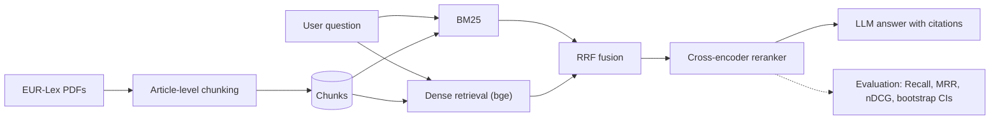

# ⚖️ EU AI Act & GDPR RAG — a grounded legal assistant with a statistically rigorous evaluation

Question-answering assistant over the **EU Artificial Intelligence Act (Regulation (EU) 2024/1689)** and the
**GDPR (Regulation (EU) 2016/679)**. Every answer cites the articles it relies on, and the system explicitly refuses
to answer when the information is not in the corpus.

What sets this project apart: an **evaluation bench** that compares several retrieval strategies on an annotated
question set, with **bootstrap confidence intervals** and **paired significance tests** between configurations.

> 🔗 **Demo**: _link to add (Hugging Face Spaces)_ · 📊 **Results**: [see Results](#results)

## Architecture



| Component | Choice | Why |
|---|---|---|
| Chunking | Split by article, then 250-word windows (50-word overlap) | Follows the legal structure; evaluation labels stay valid when chunk size changes |
| Lexical | BM25 implemented from scratch (inverted index, NumPy) | Essential for article numbers and exact legal terms |
| Dense | `BAAI/bge-m3` (multilingual) | Captures paraphrases; works in English and French |
| Fusion | Reciprocal Rank Fusion | Robust, no score calibration needed |
| Reranking | `BAAI/bge-reranker-v2-m3` | Sharpens precision in the top-k |
| Generation | Any OpenAI-compatible endpoint (Ollama by default) | Runs fully locally, no API key required |

## Quick start

```bash
git clone <your-repo> && cd rag-eu-ai-act
python -m venv .venv && source .venv/bin/activate   # Windows: .venv\Scripts\activate
pip install -e ".[all]"
```

**1. Data.** Download the English PDF versions from EUR-Lex and put them in `data/raw/`:
- AI Act, Regulation (EU) 2024/1689 → `data/raw/ai_act.pdf`
- GDPR, Regulation (EU) 2016/679 → `data/raw/gdpr.pdf`

The file name becomes the document id (`ai_act`, `gdpr`) used in the evaluation labels.

**2. Run.**

```bash
python -m ragbench.ingest                 # PDFs -> data/processed/chunks.jsonl
python -m ragbench.eval.run --configs bm25 dense hybrid hybrid_rerank --k 5
ollama pull qwen2.5:7b-instruct           # or any other model, set via LLM_MODEL
streamlit run app/streamlit_app.py        # web UI
```

With `make`: `make ingest`, `make eval`, `make app`, `make test`.

All settings are environment variables (see `src/ragbench/config.py`).

### Language

The corpus language is set with `RAG_LANG` (`en` by default, or `fr`). It controls the BM25 stopwords and the
generation prompt. To run on the French texts, use the French PDFs (`ai_act.pdf`, `rgpd.pdf`) and:

```bash
export RAG_LANG=fr
python -m ragbench.eval.run --questions data/eval/questions_fr.jsonl --configs bm25 hybrid
```

## Evaluation methodology

- **Test set**: `data/eval/questions.jsonl`, one question per line with its relevant sections
  (`"relevant": ["gdpr::Article 33"]`). Target: 150–300 questions covering factual lookups, definitions,
  multi-article questions and out-of-corpus questions.
- **Relevance unit**: the section (article), not the chunk, so that different chunking strategies are compared fairly.
- **Metrics**: Recall@k, Hit@k, MRR, nDCG@k, latency.
- **Uncertainty**: 95% bootstrap confidence intervals over questions (10,000 resamples).
- **Comparisons**: paired bootstrap on the same questions (difference B − A, 95% CI, two-sided p-value).
- **Generation** _(planned)_: faithfulness and answer relevance via LLM-as-a-judge, validated against a
  hand-labelled subsample.

## Results

_To be filled in after running the benchmark on the full test set._

| config | Recall@5 | MRR | nDCG@5 | latency |
|---|---|---|---|---|
| bm25 | | | | |
| dense | | | | |
| hybrid | | | | |
| hybrid_rerank | | | | |

## Project structure

```
src/ragbench/
  config.py       settings (env variables, language)
  chunking.py     article-level chunking
  ingest.py       PDF/HTML/TXT reading -> chunks
  retrieval.py    BM25, dense, RRF fusion, reranking
  generate.py     grounded prompt + LLM call
  pipeline.py     assembles retrieval configurations
  eval/           metrics, bootstrap, benchmark script
app/              Streamlit UI
tests/            unit tests (GitHub Actions CI)
data/eval/        annotated questions (EN and FR)
```

## Roadmap

- [x] Ingestion, article-level chunking, BM25, dense, hybrid, reranking
- [x] Retrieval benchmark with bootstrap CIs and paired tests
- [x] English / French support
- [ ] Annotated test set of 200 questions
- [ ] Ablations: chunk size, `rrf_k`, candidate pool size, embedding model
- [ ] Generation evaluation (faithfulness, out-of-corpus refusal)
- [ ] Qualitative error analysis
- [ ] Online demo + Docker image

## Limitations

Educational project, not legal advice. Consolidated versions, delegated acts and guidelines are not covered.
