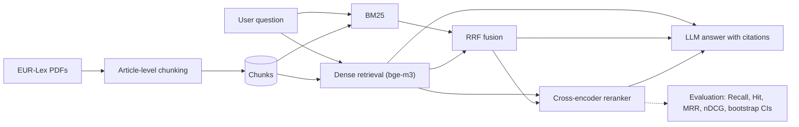

# ⚖️ EU AI Act & GDPR RAG — a grounded legal assistant with a statistically rigorous evaluation

Question-answering assistant over the **EU Artificial Intelligence Act (Regulation (EU) 2024/1689)** and the
**GDPR (Regulation (EU) 2016/679)**. Every answer cites the articles it relies on, and the system explicitly refuses
to answer when the information is not in the corpus.

What sets this project apart: an **evaluation bench** that compares several retrieval strategies on an annotated
question set, with **bootstrap confidence intervals** and **paired significance tests** between configurations.

> 🔗 **Demo**: _link to add (Hugging Face Spaces)_ · 📊 **Results**: [see Results](#results)

**Key finding so far:** on the current 50-question test set, plain dense retrieval with `bge-m3` is the best
configuration. Neither hybrid fusion nor cross-encoder reranking improves on it significantly, and reranking costs
5–6× more latency. Details and caveats in [Results](#results).

## Architecture



Five retrieval configurations can be benchmarked side by side:

| Config | Pipeline |
|---|---|
| `bm25` | Lexical retrieval only |
| `dense` | Bi-encoder retrieval only (**recommended**, see Results) |
| `hybrid` | BM25 + dense, merged with Reciprocal Rank Fusion |
| `hybrid_rerank` | `hybrid`, then the top candidates reordered by a cross-encoder |
| `dense_rerank` | `dense`, then the top candidates reordered by a cross-encoder |

| Component | Choice | Why |
|---|---|---|
| Chunking | Split by article, then 250-word windows (50-word overlap) | Follows the legal structure; evaluation labels stay valid when chunk size changes |
| Lexical | BM25 implemented from scratch (inverted index, NumPy) | Essential for article numbers and exact legal terms |
| Dense | `BAAI/bge-m3` (multilingual) | Captures paraphrases; works in English and French |
| Fusion | Reciprocal Rank Fusion | Robust, no score calibration needed |
| Reranking | `BAAI/bge-reranker-v2-m3` by default; `cross-encoder/ms-marco-MiniLM-L-6-v2` as a light alternative | The default is multilingual but too slow on a laptop CPU; the benchmark below uses the light model |
| Generation | Any OpenAI-compatible endpoint (Ollama by default) | Runs fully locally, no API key required |

## Quick start

```bash
git clone <your-repo> && cd rag-eu-ai-act
python -m venv .venv && source .venv/bin/activate   # Windows: .venv\Scripts\activate
pip install -e ".[all]"
```

**1. Data.** Download the English PDF versions from EUR-Lex and put them in `data/raw/`:
- AI Act, Regulation (EU) 2024/1689 → `data/raw/ai_act.pdf`
- GDPR, Regulation (EU) 2016/679 → `data/raw/gdpr.pdf`

The file name becomes the document id (`ai_act`, `gdpr`) used in the evaluation labels.

**2. Run.**

```bash
python -m ragbench.ingest                 # PDFs -> data/processed/chunks.jsonl
python -m ragbench.eval.run --configs dense bm25 hybrid hybrid_rerank dense_rerank --k 5
ollama pull qwen2.5:7b-instruct           # or any other model, set via LLM_MODEL
streamlit run app/streamlit_app.py        # web UI
```

With `make`: `make ingest`, `make eval`, `make app`, `make test`.

All settings are environment variables (see `src/ragbench/config.py`). The most useful ones for the benchmark:

| Variable | Default | Effect |
|---|---|---|
| `EMBEDDING_MODEL` | `BAAI/bge-m3` | Bi-encoder for dense retrieval |
| `RERANKER_MODEL` | `BAAI/bge-reranker-v2-m3` | Cross-encoder for the `*_rerank` configs |
| `N_CANDIDATES` | `50` | Candidate pool per retriever before fusion / reranking |
| `RAG_LANG` | `en` | BM25 stopwords and generation prompt language |

On a laptop without a GPU, the default reranker is very slow (over an hour for 50 questions × 50 candidates on a
MacBook Air). To reproduce the benchmark below in a few minutes:

```bash
export TOKENIZERS_PARALLELISM=false   # avoids a tokenizer deadlock on macOS
RERANKER_MODEL=cross-encoder/ms-marco-MiniLM-L-6-v2 N_CANDIDATES=20 \
  python -m ragbench.eval.run --configs dense bm25 hybrid hybrid_rerank dense_rerank --k 5
```

The first configuration listed is the baseline for paired comparisons. Each run writes per-question scores to
`results/retrieval-<timestamp>.json` and the summary tables to `results/latest.md` (overwritten on every run).

### Language

The corpus language is set with `RAG_LANG` (`en` by default, or `fr`). It controls the BM25 stopwords and the
generation prompt. To run on the French texts, use the French PDFs (`ai_act.pdf`, `rgpd.pdf`) and:

```bash
export RAG_LANG=fr
python -m ragbench.eval.run --questions data/eval/questions_fr.jsonl --configs bm25 hybrid
```

## Evaluation methodology

- **Test set**: `data/eval/questions.jsonl`, one question per line with its relevant sections
  (`"relevant": ["gdpr::Article 33"]`). Target: 150–300 questions covering factual lookups, definitions,
  multi-article questions and out-of-corpus questions.
- **Relevance unit**: the section (article), not the chunk, so that different chunking strategies are compared fairly.
- **Metrics**: Recall@k, Hit@k, MRR, nDCG@k, latency.
- **Uncertainty**: 95% bootstrap confidence intervals over questions (10,000 resamples).
- **Comparisons**: paired bootstrap on the same questions (difference B − A, 95% CI, two-sided p-value).
- **Generation** _(planned)_: faithfulness and answer relevance via LLM-as-a-judge, validated against a
  hand-labelled subsample.

## Results

**Setup.** 55 questions, of which 5 out-of-corpus questions are excluded from retrieval metrics (n = 50).
Corpus: 808 chunks (AI Act: 498, GDPR: 310). k = 5, `N_CANDIDATES` = 20, embeddings `BAAI/bge-m3`,
reranker `cross-encoder/ms-marco-MiniLM-L-6-v2`. Latency is the mean retrieval time per question on a
MacBook Air (CPU), excluding generation.

### Retrieval benchmark (n=50, k=5, 95% bootstrap CI)

| config | recall@5 | hit@5 | mrr | ndcg@5 | latency (ms) |
|---|---|---|---|---|---|
| **dense** | **0.853** [0.753, 0.937] | **0.900** [0.800, 0.980] | **0.769** [0.664, 0.860] | **0.784** [0.682, 0.874] | 92 |
| bm25 | 0.700 [0.577, 0.820] | 0.740 [0.620, 0.860] | 0.531 [0.417, 0.652] | 0.564 [0.451, 0.678] | <1 |
| hybrid | 0.830 [0.723, 0.923] | 0.860 [0.760, 0.940] | 0.644 [0.533, 0.757] | 0.678 [0.575, 0.777] | 77 |
| hybrid_rerank | 0.880 [0.787, 0.960] | 0.900 [0.800, 0.980] | 0.735 [0.631, 0.830] | 0.765 [0.670, 0.850] | 492 |
| dense_rerank | 0.853 [0.753, 0.940] | 0.880 [0.780, 0.960] | 0.742 [0.637, 0.840] | 0.761 [0.661, 0.852] | 498 |

### Paired comparisons vs `dense` (difference, 95% CI, p-value)

| config | recall@5 | hit@5 | mrr | ndcg@5 |
|---|---|---|---|---|
| bm25 | -0.153 [-0.280, -0.027] p=0.021 | -0.160 [-0.300, -0.040] p=0.019 | -0.238 [-0.362, -0.110] p<0.001 | -0.221 [-0.341, -0.100] p<0.001 |
| hybrid | -0.023 [-0.113, +0.063] p=0.651 | -0.040 [-0.140, +0.060] p=0.550 | -0.125 [-0.235, -0.016] p=0.022 | -0.106 [-0.200, -0.016] p=0.017 |
| hybrid_rerank | +0.027 [-0.077, +0.127] p=0.629 | +0.000 [-0.100, +0.100] p=1.000 | -0.034 [-0.132, +0.063] p=0.498 | -0.019 [-0.109, +0.071] p=0.685 |
| dense_rerank | +0.000 [-0.110, +0.110] p=1.000 | -0.020 [-0.120, +0.080] p=0.844 | -0.027 [-0.125, +0.070] p=0.603 | -0.023 [-0.117, +0.069] p=0.639 |

### Analysis

- **Dense retrieval is the best configuration.** `bge-m3` alone retrieves a relevant article in the top 5 for
  90% of the questions, and the first relevant result sits on average between rank 1 and 2 (MRR = 0.77).
- **BM25 is clearly weaker** than dense on every metric (p < 0.05; p < 0.001 for MRR and nDCG). Many test
  questions paraphrase the legal text rather than reuse its exact wording, which penalises lexical matching.
- **Hybrid fusion hurts the ranking.** It finds as many relevant articles as dense (recall@5 and hit@5 not
  significantly different), but ranks them lower: MRR −0.125 (p = 0.022), nDCG −0.106 (p = 0.017). With equal
  weights, RRF lets the much weaker BM25 ranking push down good dense results.
- **Reranking does not beat dense alone.** The cross-encoder repairs most of the hybrid ranking (MRR 0.644 →
  0.735), but neither `hybrid_rerank` nor `dense_rerank` differs significantly from `dense` (all p ≥ 0.49), while
  multiplying retrieval latency by 5–6. A likely reason: the light MiniLM reranker was trained on web search
  queries (MS MARCO), not on legal text, and judges article relevance no better than `bge-m3`.
- **Retained configuration: `dense`**, the most accurate and one of the fastest.

### Limitations of these results

- **Small test set.** With n = 50, confidence intervals are about ±0.1 wide: the benchmark can only rule out
  gains larger than roughly 0.1. "Not significant" does not mean "no difference".
- **Labels not yet verified.** The relevant articles of 51 questions have not been checked by hand
  (`"verified": false`); a wrong label can turn a correct retrieval into a miss.
- **Light reranker only.** The default `bge-reranker-v2-m3` (multilingual, much larger) could not be run in a
  reasonable time on a laptop CPU. It may perform better and is worth testing on a GPU.
- **Hyper-parameters not tuned.** `rrf_k` = 60 and equal fusion weights were used as is; a dense-weighted fusion
  might let the hybrid configuration catch up with or exceed dense.

## Project structure

```
src/ragbench/
  config.py       settings (env variables, language)
  chunking.py     article-level chunking
  ingest.py       PDF/HTML/TXT reading -> chunks
  retrieval.py    BM25, dense, RRF fusion, reranking
  generate.py     grounded prompt + LLM call
  pipeline.py     assembles retrieval configurations
  eval/           metrics, bootstrap, benchmark script
app/              Streamlit UI
tests/            unit tests (GitHub Actions CI)
data/eval/        annotated questions (EN and FR)
results/          benchmark outputs (JSON per question, Markdown summary)
```

## Roadmap

- [x] Ingestion, article-level chunking, BM25, dense, hybrid, reranking
- [x] Retrieval benchmark with bootstrap CIs and paired tests
- [x] English / French support
- [x] First benchmark of 5 configurations (n = 50) — dense retrieval retained
- [ ] Hand-verify the labels of the current test set
- [ ] Annotated test set of 200 questions
- [ ] Benchmark the default reranker `bge-reranker-v2-m3` on a GPU
- [ ] Ablations: weighted RRF, `rrf_k`, candidate pool size, chunk size, embedding model
- [ ] Generation evaluation (faithfulness, out-of-corpus refusal)
- [ ] Qualitative error analysis
- [ ] Online demo + Docker image

## Limitations

Educational project, not legal advice. Consolidated versions, delegated acts and guidelines are not covered.
